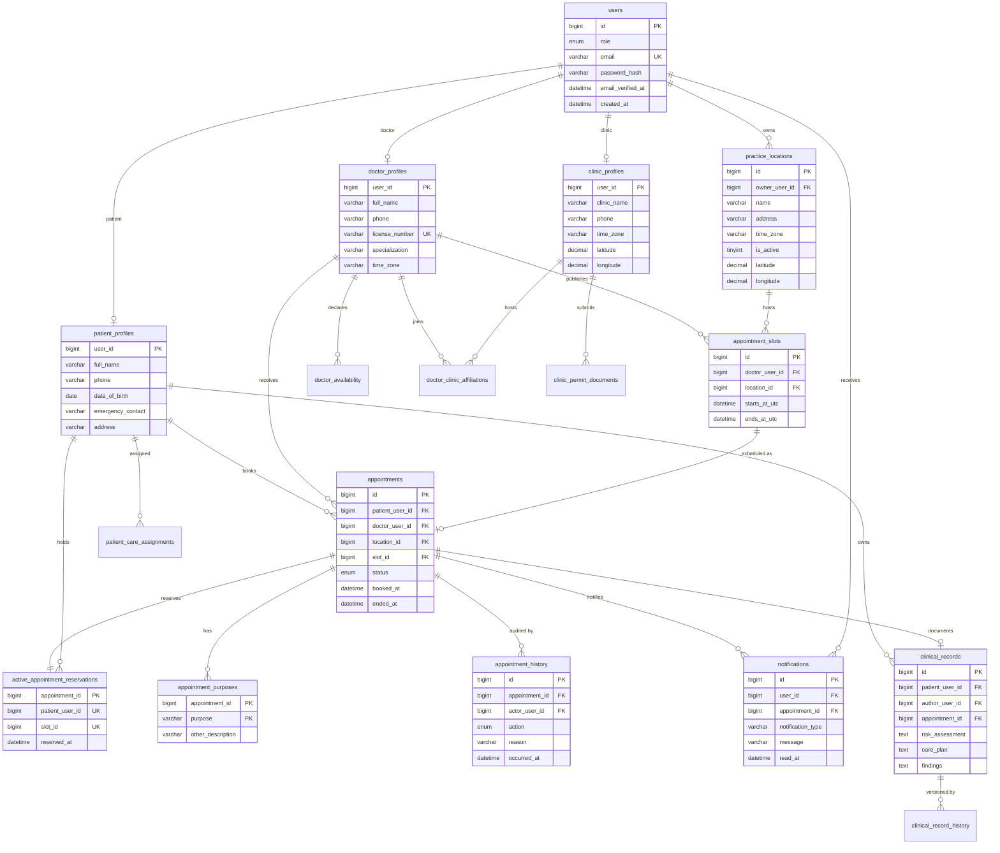

# Database design

Rubric phase: Database design (8 points). The live schema is the source of truth; `Database/Ob-Gyn.sql` is generated from it and verified by importing into an empty database.

## 1. Design goals

1. **One identity, three roles.** Every account is a row in `users`; role-specific facts live in `patient_profiles`, `doctor_profiles`, or `clinic_profiles`.
2. **Time is stored in UTC.** `appointment_slots.starts_at_utc` / `ends_at_utc` use UTC; the display time zone belongs to the practice location, so a slot keeps its meaning across travellers and DST-free Philippine time.
3. **Bookings cannot collide.** One active appointment per patient and one patient per slot are enforced by unique indexes, not only by application code.
4. **History is append-only.** `appointment_history` records every booked/cancelled/completed/no-show transition; `clinical_record_history` does the same for records.
5. **Reference data is separate.** PSGC address codes are validated against the bundled PSA dataset; the database stores the chosen codes and a composed address.

## 2. Core entity-relationship diagram



## 3. How concurrency is actually prevented

The important constraint is not a `SELECT` check but two unique indexes:

```sql
-- active_appointment_reservations
PRIMARY KEY (appointment_id)
UNIQUE KEY uq_reservation_patient (patient_user_id)
UNIQUE KEY uq_reservation_slot (slot_id)
```

A patient can hold at most one active reservation, and a slot can be held by at most one patient. Two simultaneous booking requests race on those indexes; exactly one `INSERT` succeeds and the other receives `409`. The integration suite proves this with parallel HTTP requests (`PASS concurrent booking: 201,409`).

Reservations are released when an appointment is cancelled, completed, marked no-show, or auto-completed after its slot ends (`gc_release_finished_appointments()`). In the live database, the auto-complete path also fixed the original defect where a past appointment blocked all future bookings.

## 4. Normalisation notes

- **3NF for identity.** `users` holds only login data; profile tables hold display and contact data. This removed the earlier duplication where `users.full_name` and the profile name could disagree.
- **Slot as its own entity.** A slot exists before a booking and can be listed, filtered, and reused after cancellation. Storing start/end only on `appointments` would duplicate time data and make availability queries harder.
- **Purposes as a child table.** An appointment can have several purposes; `appointment_purposes` has a composite primary key `(appointment_id, purpose)`, so duplicates are impossible.
- **History tables are append-only** and intentionally denormalised: they keep the reason text as it was at the time, even if the appointment changes later.
- **Deliberate denormalisation:** `appointment_history.reason` and `notifications.message` store rendered text for audit readability. They are immutable snapshots, not derived caches.

## 5. Index strategy

| Index | Purpose |
| --- | --- |
| `uq_users_email` | Login lookup, duplicate registration prevention |
| `uq_doctor_slot_start (doctor_user_id, starts_at_utc)` | Prevents publishing two slots with the same start |
| `ix_slots_location_time (location_id, starts_at_utc)` | Availability search by location and date |
| `ix_appointments_patient_status` | "My appointments" and active-booking checks |
| `ix_appointments_doctor_time` | Doctor's schedule view |
| `uq_reservation_patient` / `uq_reservation_slot` | Concurrency rules above |
| `ix_audit_log_user`, `ix_audit_log_action` | Security review queries |
| `ix_notifications_user_unread` | Unread badge and notification list |

All foreign keys are indexed, so InnoDB does not need full scans to validate cascades and joins.

## 6. Time-zone handling

- API session runs with `SET time_zone = '+00:00'`, so `UTC_TIMESTAMP()` is unambiguous.
- Doctor input is interpreted in the practice location's IANA zone (default `Asia/Manila`) and converted to UTC before insert.
- Availability queries compare `starts_at_utc > UTC_TIMESTAMP()`.
- The client formats UTC back into the location's zone, so a 9:00 AM Manila slot shows as 9:00 AM regardless of the viewer's laptop zone.

## 7. Fresh-install verification

`Database/Ob-Gyn.sql` was regenerated from the live schema on 2026-11-15 and checked three ways:

1. Column-by-column and index-by-index comparison against the live database: **0 differences**.
2. Import into an empty database: **20 tables, 38 foreign keys, 62 indexes, `audit_log` present**.
3. Seed sample data into that empty database and run both automated suites: **all checks pass**.

## 8. Data handling and privacy

- Passwords and verification codes are stored only as Argon2id hashes.
- Sessions live server-side; the cookie holds only the session ID.
- Coordinates are stored but not shown to patients; the map uses them to place pins.
- Clinical-record editing is a preview and is not persisted, so the capstone does not store diagnosis text.
- Deletion order in tests follows foreign keys; production would use soft deletes for medical data.

## 9. Data dictionary

Generated from the live `gentlecare_v2` schema on 2026-11-15.

### `active_appointment_reservations`

| Column | Type | Null | Default | Key |
| --- | --- | --- | --- | --- |
| `appointment_id` | bigint(20) unsigned | NO | — | PK FK→appointments.id |
| `patient_user_id` | bigint(20) unsigned | NO | — | UNIQUE FK→patient_profiles.user_id |
| `slot_id` | bigint(20) unsigned | NO | — | UNIQUE FK→appointment_slots.id |
| `reserved_at` | datetime | NO | `current_timestamp()` |  |

### `appointments`

| Column | Type | Null | Default | Key |
| --- | --- | --- | --- | --- |
| `id` | bigint(20) unsigned | NO | — (auto_increment) | PK |
| `patient_user_id` | bigint(20) unsigned | NO | — | INDEX FK→patient_profiles.user_id |
| `doctor_user_id` | bigint(20) unsigned | NO | — | INDEX FK→doctor_profiles.user_id |
| `location_id` | bigint(20) unsigned | NO | — | INDEX FK→practice_locations.id |
| `slot_id` | bigint(20) unsigned | NO | — | INDEX FK→appointment_slots.id |
| `status` | enum('confirmed','completed','cancelled','rescheduled','no_show') | NO | `'confirmed'` |  |
| `booked_at` | datetime | NO | `current_timestamp()` |  |
| `ended_at` | datetime | YES | `NULL` |  |
| `created_by` | bigint(20) unsigned | NO | — | INDEX FK→users.id |

### `appointment_history`

| Column | Type | Null | Default | Key |
| --- | --- | --- | --- | --- |
| `id` | bigint(20) unsigned | NO | — (auto_increment) | PK |
| `appointment_id` | bigint(20) unsigned | NO | — | INDEX FK→appointments.id |
| `replacement_appointment_id` | bigint(20) unsigned | YES | `NULL` | INDEX FK→appointments.id |
| `actor_user_id` | bigint(20) unsigned | NO | — | INDEX FK→users.id |
| `action` | enum('booked','cancelled','rescheduled','completed','no_show','schedule_change_rejected') | NO | — |  |
| `reason` | varchar(500) | YES | `NULL` |  |
| `occurred_at` | datetime | NO | `current_timestamp()` |  |

### `appointment_purposes`

| Column | Type | Null | Default | Key |
| --- | --- | --- | --- | --- |
| `appointment_id` | bigint(20) unsigned | NO | — | PK FK→appointments.id |
| `purpose` | varchar(80) | NO | — | PK |
| `other_description` | varchar(255) | YES | `NULL` |  |

### `appointment_slots`

| Column | Type | Null | Default | Key |
| --- | --- | --- | --- | --- |
| `id` | bigint(20) unsigned | NO | — (auto_increment) | PK |
| `doctor_user_id` | bigint(20) unsigned | NO | — | INDEX FK→doctor_profiles.user_id |
| `location_id` | bigint(20) unsigned | NO | — | INDEX FK→practice_locations.id |
| `starts_at_utc` | datetime | NO | — |  |
| `ends_at_utc` | datetime | NO | — |  |
| `created_by` | bigint(20) unsigned | NO | — | INDEX FK→users.id |
| `created_at` | datetime | NO | `current_timestamp()` |  |

### `audit_log`

| Column | Type | Null | Default | Key |
| --- | --- | --- | --- | --- |
| `id` | bigint(20) | NO | — (auto_increment) | PK |
| `user_id` | bigint(20) | YES | `NULL` | INDEX |
| `action` | varchar(50) | NO | — | INDEX |
| `result` | varchar(20) | NO | — |  |
| `ip` | varchar(45) | NO | — |  |
| `created_at` | timestamp | NO | `current_timestamp()` | INDEX |

### `auth_rate_limits`

| Column | Type | Null | Default | Key |
| --- | --- | --- | --- | --- |
| `id` | bigint(20) unsigned | NO | — (auto_increment) | PK |
| `bucket` | varchar(32) | NO | — | INDEX |
| `limit_key` | char(64) | NO | — |  |
| `attempted_at` | datetime | NO | — |  |

### `clinical_records`

| Column | Type | Null | Default | Key |
| --- | --- | --- | --- | --- |
| `id` | bigint(20) unsigned | NO | — (auto_increment) | PK |
| `patient_user_id` | bigint(20) unsigned | NO | — | INDEX FK→patient_profiles.user_id |
| `author_user_id` | bigint(20) unsigned | NO | — | INDEX FK→users.id |
| `appointment_id` | bigint(20) unsigned | YES | `NULL` | INDEX FK→appointments.id |
| `prenatal_classification` | varchar(80) | YES | `NULL` |  |
| `risk_assessment` | text | YES | `NULL` |  |
| `care_plan` | text | YES | `NULL` |  |
| `findings` | text | YES | `NULL` |  |
| `follow_up_suggestion` | text | YES | `NULL` |  |
| `updated_by` | bigint(20) unsigned | NO | — | INDEX FK→users.id |
| `created_at` | datetime | NO | `current_timestamp()` |  |
| `updated_at` | datetime | NO | `current_timestamp()` (on update current_timestamp()) |  |

### `clinical_record_history`

| Column | Type | Null | Default | Key |
| --- | --- | --- | --- | --- |
| `id` | bigint(20) unsigned | NO | — (auto_increment) | PK |
| `clinical_record_id` | bigint(20) unsigned | NO | — | INDEX FK→clinical_records.id |
| `actor_user_id` | bigint(20) unsigned | NO | — | INDEX FK→users.id |
| `change_summary` | varchar(500) | NO | — |  |
| `occurred_at` | datetime | NO | `current_timestamp()` |  |

### `clinic_permit_documents`

| Column | Type | Null | Default | Key |
| --- | --- | --- | --- | --- |
| `id` | bigint(20) unsigned | NO | — (auto_increment) | PK |
| `clinic_user_id` | bigint(20) unsigned | NO | — | INDEX FK→clinic_profiles.user_id |
| `original_filename` | varchar(255) | NO | — |  |
| `stored_filename` | char(64) | NO | — | UNIQUE |
| `mime_type` | varchar(100) | NO | — |  |
| `byte_size` | int(10) unsigned | NO | — |  |
| `submitted_at` | datetime | NO | `current_timestamp()` |  |

### `clinic_profiles`

| Column | Type | Null | Default | Key |
| --- | --- | --- | --- | --- |
| `user_id` | bigint(20) unsigned | NO | — | PK FK→users.id |
| `clinic_name` | varchar(160) | NO | — |  |
| `phone` | varchar(16) | YES | `NULL` |  |
| `address` | varchar(255) | NO | — |  |
| `time_zone` | varchar(64) | NO | — |  |
| `latitude` | decimal(10,7) | YES | `NULL` |  |
| `longitude` | decimal(10,7) | YES | `NULL` |  |

### `doctor_availability`

| Column | Type | Null | Default | Key |
| --- | --- | --- | --- | --- |
| `id` | bigint(20) unsigned | NO | — (auto_increment) | PK |
| `doctor_user_id` | bigint(20) unsigned | NO | — | INDEX FK→doctor_profiles.user_id |
| `location_id` | bigint(20) unsigned | NO | — | INDEX FK→practice_locations.id |
| `weekday` | tinyint(3) unsigned | NO | — |  |
| `local_start` | time | NO | — |  |
| `local_end` | time | NO | — |  |
| `valid_from` | date | NO | — |  |
| `valid_until` | date | YES | `NULL` |  |
| `created_at` | datetime | NO | `current_timestamp()` |  |

### `doctor_clinic_affiliations`

| Column | Type | Null | Default | Key |
| --- | --- | --- | --- | --- |
| `id` | bigint(20) unsigned | NO | — (auto_increment) | PK |
| `doctor_user_id` | bigint(20) unsigned | NO | — | INDEX FK→doctor_profiles.user_id |
| `clinic_user_id` | bigint(20) unsigned | NO | — | INDEX FK→clinic_profiles.user_id |
| `status` | enum('requested','active','rejected','ended') | NO | `'requested'` |  |
| `requested_at` | datetime | NO | `current_timestamp()` |  |
| `decided_at` | datetime | YES | `NULL` |  |
| `decided_by` | bigint(20) unsigned | YES | `NULL` | INDEX FK→users.id |
| `ended_at` | datetime | YES | `NULL` |  |

### `doctor_clinic_affiliation_history`

| Column | Type | Null | Default | Key |
| --- | --- | --- | --- | --- |
| `id` | bigint(20) unsigned | NO | — (auto_increment) | PK |
| `affiliation_id` | bigint(20) unsigned | NO | — | INDEX FK→doctor_clinic_affiliations.id |
| `actor_user_id` | bigint(20) unsigned | NO | — | INDEX FK→users.id |
| `action` | enum('requested','accepted','rejected','ended') | NO | — |  |
| `occurred_at` | datetime | NO | `current_timestamp()` |  |

### `doctor_profiles`

| Column | Type | Null | Default | Key |
| --- | --- | --- | --- | --- |
| `user_id` | bigint(20) unsigned | NO | — | PK FK→users.id |
| `full_name` | varchar(120) | YES | `NULL` |  |
| `phone` | varchar(16) | YES | `NULL` |  |
| `license_number` | varchar(80) | NO | — | UNIQUE |
| `specialization` | varchar(120) | NO | — |  |
| `time_zone` | varchar(64) | NO | — |  |

### `notifications`

| Column | Type | Null | Default | Key |
| --- | --- | --- | --- | --- |
| `id` | bigint(20) unsigned | NO | — (auto_increment) | PK |
| `user_id` | bigint(20) unsigned | NO | — | INDEX FK→users.id |
| `appointment_id` | bigint(20) unsigned | YES | `NULL` | INDEX FK→appointments.id |
| `notification_type` | varchar(60) | NO | — |  |
| `message` | varchar(500) | NO | — |  |
| `created_at` | datetime | NO | `current_timestamp()` |  |
| `read_at` | datetime | YES | `NULL` |  |

### `patient_care_assignments`

| Column | Type | Null | Default | Key |
| --- | --- | --- | --- | --- |
| `id` | bigint(20) unsigned | NO | — (auto_increment) | PK |
| `patient_user_id` | bigint(20) unsigned | NO | — | INDEX FK→patient_profiles.user_id |
| `professional_user_id` | bigint(20) unsigned | NO | — | INDEX FK→users.id |
| `assigned_by` | bigint(20) unsigned | NO | — | INDEX FK→users.id |
| `assigned_at` | datetime | NO | `current_timestamp()` |  |
| `ended_at` | datetime | YES | `NULL` |  |

### `patient_profiles`

| Column | Type | Null | Default | Key |
| --- | --- | --- | --- | --- |
| `user_id` | bigint(20) unsigned | NO | — | PK FK→users.id |
| `full_name` | varchar(120) | YES | `NULL` |  |
| `phone` | varchar(16) | YES | `NULL` |  |
| `date_of_birth` | date | NO | — |  |
| `emergency_contact` | varchar(160) | NO | — |  |
| `address` | varchar(255) | YES | `NULL` |  |

### `practice_locations`

| Column | Type | Null | Default | Key |
| --- | --- | --- | --- | --- |
| `id` | bigint(20) unsigned | NO | — (auto_increment) | PK |
| `owner_user_id` | bigint(20) unsigned | NO | — | INDEX FK→users.id |
| `name` | varchar(160) | NO | — |  |
| `address` | varchar(255) | NO | — |  |
| `time_zone` | varchar(64) | NO | — |  |
| `is_active` | tinyint(1) | NO | `1` |  |
| `created_at` | datetime | NO | `current_timestamp()` |  |
| `latitude` | decimal(10,7) | YES | `NULL` |  |
| `longitude` | decimal(10,7) | YES | `NULL` |  |

### `users`

| Column | Type | Null | Default | Key |
| --- | --- | --- | --- | --- |
| `id` | bigint(20) unsigned | NO | — (auto_increment) | PK |
| `role` | enum('patient','doctor','clinic') | NO | — |  |
| `email` | varchar(254) | NO | — | UNIQUE |
| `password_hash` | varchar(255) | NO | — |  |
| `email_verified_at` | datetime | YES | `NULL` |  |
| `verification_code_hash` | varchar(255) | YES | `NULL` |  |
| `verification_expires_at` | datetime | YES | `NULL` |  |
| `verification_attempts` | tinyint(3) unsigned | NO | `0` |  |
| `created_at` | datetime | NO | `current_timestamp()` |  |
| `updated_at` | datetime | NO | `current_timestamp()` (on update current_timestamp()) |  |

